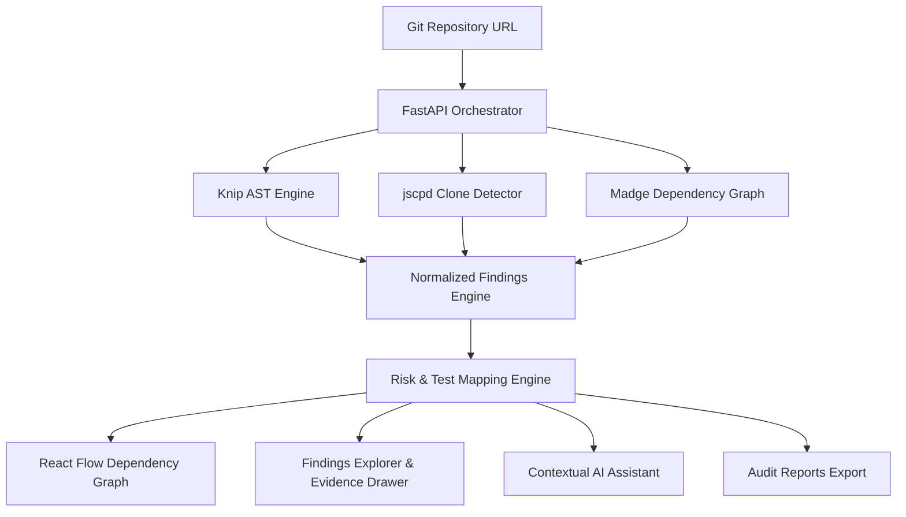

# ⚡ CodeImpact (DeadCode-Detective)

> **Intelligent Codebase Cleanup & Blast-Radius Assessment Platform**  
> *Evidence-first static analysis, circular dependency mapping, and grounded AI verification before you touch or delete a single line of code.*

---

## 📌 Executive Summary

Modern engineering teams accumulate significant technical debt in the form of dead exports, unreferenced files, copy-pasted clones, and intricate circular dependency cycles. Deleting code is risky because static tools often miss dynamic imports, reflection, framework file-routing conventions, and public library consumers.

**CodeImpact** bridges the gap between raw AST detection and responsible refactoring. Instead of claiming code is "safe to delete", CodeImpact provides:
- **Multi-Engine Static AST Analysis** (Knip, jscpd, Madge)
- **Dependency Topology & Blast Radius Modeling** (in-degree/out-degree fan-out, direct callers)
- **Circular Dependency Detection** (visualized with animated warning flows)
- **Automated Test Mapping** (identifying which test suites guard each symbol)
- **Grounded AI Reviewer** (strictly refuses to fabricate safety claims; highlights dynamic blind spots)
- **Audit-Grade Compliance Reports** (Printable PDF, structured JSON, CSV, and GitHub-flavored Markdown)

---

## 🚀 Live Demo & Core Capabilities



### 1. 📊 Overview Dashboard
- Repository URL input & instant demo repo switcher (React, Vue, Express, TypeScript)
- Real-time terminal log stream with simulated AST parser output
- Key health indicators: Health Score, Circular Cycles, Hotspots, Duplication Index

### 2. 🔍 Findings Explorer & Evidence Drawer
- Filter by Category (*Unused Code, Clones, Circular Loops, Hotspots*) & Severity (*Critical, High, Medium, Low*)
- Deep evidence drawer displaying exact file paths, line ranges, AST code snippets, and confidence scores
- Review status tracker (*Pending Review, In Review, Verified for Refactor, False Positive, High Risk*)
- One-click shortcuts to inspect module in the Dependency Graph or consult the AI Assistant

### 3. 🕸️ Interactive Dependency Graph
- Powered by `@xyflow/react` (React Flow)
- Nodes color-coded by role (*Entry, Standard, Hotspot, Unused, Cycle*)
- Animated red dashed edges highlighting dangerous circular dependency cycles
- Focus mode isolating selected nodes and their 1-hop inbound/outbound neighbors
- Search query, category filters, and node zoom/fit controls

### 4. 🤖 Contextual AI Assistant
- Grounded intelligence with 8 specialized query handlers:
  1. *Safety assessment & delete blast radius*
  2. *Detection mechanism & analyzer evidence breakdown*
  3. *Downstream caller impact & potential failure modes*
  4. *Dependency fan-in / fan-out analysis*
  5. *Mapped test suites & recommended test commands*
  6. *Reliability & false-positive scenario evaluation*
  7. *Plain English ELI5 summaries*
  8. *Responsible verification checklists*
- Source badges distinguishing **Gemini API** responses from **Grounded Engine** fallbacks
- Strict adherence to verification guardrails: never claims unverified safety

### 5. 📑 Reports & Artifact Export
- **PDF Executive Audit**: Styled print preview with summary metrics, finding cards, and printable layout
- **JSON Machine Payload**: Complete serialized schema with AST metadata and dependency topology
- **CSV Spreadsheet**: RFC 4180 compliant tabular export for Jira/spreadsheet import
- **Markdown Document**: Ready-to-paste report for GitHub Pull Requests and issue threads
- Section toggles & category/severity filters for custom reports

### 6. ⚔️ Competitor Benchmark Matrix
- Detailed comparison against SonarQube, Knip standalone, Madge standalone, and Copilot

---

## 🛠️ Tech Stack & Architecture

| Layer | Technologies |
|---|---|
| **Frontend UI** | React 18, TypeScript, Vite, Tailwind CSS, Lucide Icons |
| **Graph Visualization** | `@xyflow/react` (React Flow v12) |
| **Backend API** | FastAPI (Python 3.10+), Pydantic, Uvicorn |
| **Static Analyzers** | Knip (unused exports), jscpd (clones), Madge (cycles & graph) |
| **AI Integration** | Google Gemini API (via google-genai) / Deterministic Grounded Engine |
| **Styling & Theme** | Gen-Z Red (`#FF2E55`), Dark Surface (`#0F0F12`), JetBrains Mono |

---

## ⚙️ Getting Started

### Prerequisites
- **Node.js** >= 18.0.0
- **npm** or **pnpm**
- **Python** >= 3.10 (optional, for running the backend API)

---

### Frontend Setup (Standalone Demo Mode)

The frontend is fully functional out of the box with comprehensive mock data and deterministic client-side analysis:

```bash
# 1. Navigate to frontend
cd frontend

# 2. Install dependencies
npm install

# 3. Start development server (runs on http://localhost:3000)
npm run dev

# 4. Create production build
npm run build
```

---

### Backend Setup (FastAPI & Analyzer Tools)

```bash
# 1. Navigate to backend
cd backend

# 2. Create and activate virtual environment
python -m venv venv
# Windows:
.\venv\Scripts\activate
# macOS/Linux:
source venv/bin/activate

# 3. Install Python dependencies
pip install -r requirements.txt

# 4. Configure environment variables
cp .env.example .env
# Edit .env and set GEMINI_API_KEY (optional)

# 5. Start the FastAPI server (runs on http://localhost:8000)
uvicorn app.main:app --reload --port 8000
```

---

### Connecting Frontend to Backend

In `frontend/`, create a `.env` file (or copy from `.env.example`):

```bash
VITE_API_URL=http://localhost:8000
```

When `VITE_API_URL` is set, the frontend automatically routes live scan triggers, finding queries, graph retrievals, and AI consultations through the backend REST endpoints. If the backend is unavailable, it gracefully falls back to the deterministic client-side engine.

---

## 📡 Backend API Contract

| Endpoint | Method | Description |
|---|---|---|
| `/api/repositories/analyse` | `POST` | Start a new repository analysis (returns `202 Accepted`) |
| `/api/analyses/{id}` | `GET` | Get status and executive summary metrics |
| `/api/analyses/{id}/findings` | `GET` | Retrieve paginated, filterable findings list |
| `/api/analyses/{id}/findings/{finding_id}` | `GET` | Detailed finding inspection with evidence snippet |
| `/api/analyses/{id}/graph` | `GET` | Dependency graph nodes, import edges, and cycle chains |
| `/api/analyses/{id}/explain` | `POST` | Grounded AI explanation using Gemini |
| `/api/analyses/{id}/report` | `GET` | Generate and download markdown audit report |

---

## 👥 Team & Workstream Allocation

Developed for Hacktoberfest / Hackathon by:

- **BHOOMI_1 (Branch `B`)**: Complete Frontend Architecture, Dashboard, Findings Explorer, React Flow Dependency Graph, Contextual AI Assistant, Reports & Export, UI/UX Polish.
- **OM_2 (Branch `om`)**: Static Analysis Engine Integration (Knip runner, jscpd runner, AST normalizer, workspace cloning).
- **SAMAR_3 (Branch `S`)**: Dependency Impact Engine, Madge Graph Runner, Circular Cycle Detection, Risk Engine, Test Impact Mapping.
- **TANUJA_4 (Branch `T`)**: FastAPI Backend Architecture, REST API Routing, Analysis Orchestrator, Gemini Service Integration.

---

## 🛡️ Responsible Engineering & Guardrails

> [!CAUTION]
> **Static Analysis Blind Spots**: No static analysis engine can unconditionally guarantee that code is safe to delete. Dynamic calls (`import(...)`, `eval`, dictionary lookups), framework convention routing (Next.js, Remix, Astro), and public library APIs are invisible to static AST parsers. Always verify with automated tests before deleting code.

---

## 📄 License

This project is licensed under the **MIT License**.
