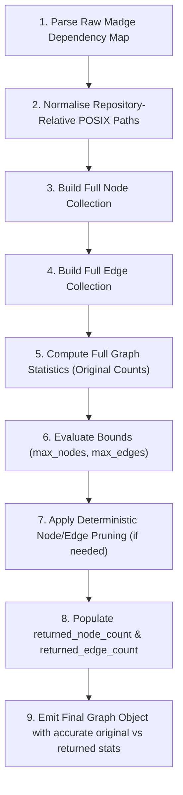

# SAMAR_3: Dependency & Impact Engine
## Phase 2: Pre-Implementation Validation Document

**Document Version:** 1.0.0  
**Date:** 2026-10-31  
**Author:** SAMAR_3 (Dependency & Impact Engine Architect)  
**Status:** VALIDATION COMPLETE (Decisions Locked)  
**Timebox:** 10–15 minutes  
**Target Module:** `backend/app/services/dependency_impact/`  

---

## 1. Objective

Validate four critical engineering decisions and runtime environment prerequisites prior to implementing the Madge subprocess runner:
1. Verification of Node.js and Madge CLI availability in the host execution environment.
2. Formalization of analysis status classifications and structured failure-state handling.
3. Locking the canonical graph schema and edge-direction semantics.
4. Definition of graph statistics calculation order and deterministic truncation rules.

---

## 2. Environment Inspection Results (Checkpoint 1)

All checks were executed safely in the workspace environment (`C:\DeadCode`) without installing or updating packages.

### 2.1 Inspection Evidence
- **Host OS:** Windows (PowerShell environment)
- **Node.js:** Executed `node --version` → Output: `v24.14.0` (AVAILABLE)
- **npm:** Executed `npm --version` → Output: `11.9.0` (AVAILABLE)
- **Global Madge:** Executed `madge --version` → Output: Not found on PATH (`CommandNotFoundException`)
- **npx without install:** Executed `npx --no-install madge --version` → Output: `npm error npx canceled due to missing packages: ["madge@8.0.0"]` (NOT INSTALLED)
- **Tooling Package:** `tooling/package.json` exists as a 0-byte placeholder.
- **Local node_modules:** No `node_modules` directory exists in the workspace.

### 2.2 Summary Table

| Check | Result | Evidence |
| :--- | :--- | :--- |
| **Node.js** | **Available** | `v24.14.0` |
| **npm** | **Available** | `11.9.0` |
| **Global Madge** | **Missing** | Command not recognized on PATH |
| **Local Madge** | **Missing** | No `node_modules` in workspace |
| **Tooling Dependency** | **Not declared** | `tooling/package.json` is currently 0 bytes |
| **Recommended Strategy** | **Strategy D → C (Declared Tooling Dependency)** | Runtime gracefully reports `unavailable` / `MADGE_NOT_FOUND` when missing; declare and install pinned Madge in `tooling/` upon user authorization |

---

## 3. Failure-State Handling & Error Contract (Checkpoint 2)

A primary flaw in naïve dependency pipelines is converting a tool execution crash into an empty dictionary, which misrepresents a broken analysis as "zero dependencies exist".

### 3.1 Canonical Analysis Statuses
Every dependency extraction attempt produces one of four canonical states:

```text
success | partial | failed | unavailable
```

- **`success`**: Madge executed successfully, emitted valid JSON, dependencies and cycles parsed cleanly.
- **`partial`**: Analysis completed with warnings, or partial module resolution occurred (e.g., syntax warning in one file, but other modules parsed).
- **`failed`**: Subprocess crashed, returned a non-zero exit code, timed out, or produced unparseable JSON. No trustworthy dependency model can be established.
- **`unavailable`**: Madge CLI is not installed or not discoverable in the runtime environment.

### 3.2 Canonical Error Codes
- `MADGE_NOT_FOUND`: Executable not found in PATH or local `node_modules/.bin`.
- `MADGE_EXECUTION_FAILED`: Subprocess exited with a non-zero return code.
- `MADGE_TIMEOUT`: Subprocess exceeded configured execution deadline (default 30s).
- `MADGE_INVALID_JSON`: Subprocess stdout could not be parsed as JSON.
- `REPOSITORY_PATH_INVALID`: Specified `repo_path` is empty or malformed.
- `REPOSITORY_NOT_FOUND`: Specified `repo_path` does not exist on disk.
- `MADGE_PARTIAL_OUTPUT`: Tool exited with warnings or incomplete module coverage.

### 3.3 Structured Error Output
When extraction cannot succeed:

```json
{
  "status": "failed",
  "dependency_map": null,
  "cycles": null,
  "error": {
    "code": "MADGE_EXECUTION_FAILED",
    "message": "Madge returned non-zero exit code 1: SyntaxError in src/broken.ts",
    "retryable": false
  },
  "warnings": []
}
```

### 3.4 Critical Failure Rules
- **RULE 1:** Never convert a Madge failure into an empty map `{"dependency_map": {}, "cycles": []}`.
- **RULE 2:** An empty dependency map is valid ONLY when Madge exits with code 0 and genuinely reports `{}` (e.g., zero imports in project).
- **RULE 3:** A failed analysis must never be returned to the frontend as a successful empty graph.
- **RULE 4:** Capture and preserve all warnings and stderr logs for diagnostic transparency.
- **RULE 5:** Scrub and sanitize all absolute machine paths (e.g. `C:\DeadCode\...`) before emitting error messages or findings.
- **RULE 6:** Never fabricate missing edges, nodes, or cycles.

### 3.5 Downstream Behavior in Impact Analyzer & Graph Builder

| Extraction Status | Graph Builder Handling | Finding Impact Handling |
| :--- | :--- | :--- |
| **`success`** | Builds complete graph nodes, edges, cycles, stats | Computes direct dependants/dependencies, test mapping, and review risk |
| **`partial`** | Builds available graph; sets `status: "partial"`; attaches warnings | Computes impact with caution flags; missing evidence flagged |
| **`failed`** | Returns `nodes: []`, `edges: []`, `status: "failed"`, `stats.node_count: 0` | Enriches findings with `review_risk: "unknown"`, `impact: null`, error explanation |
| **`unavailable`** | Returns `nodes: []`, `edges: []`, `status: "unavailable"` | Enriches findings with `review_risk: "unknown"`, `impact: null`, tool missing note |

---

## 4. Graph Schema Consistency & Direction (Checkpoint 3)

### 4.1 Canonical Edge Format
The canonical edge schema across all modules is:

```json
{
  "id": "src/main.ts->src/app.ts",
  "source": "src/main.ts",
  "target": "src/app.ts",
  "relationship": "imports"
}
```

### 4.2 Compatibility Decision (`relationship` vs `type`)
- In `docs/TRD.md` Section 10.2, `"type": "import"` was mentioned.
- In `docs/implementation-plans/BHOOMI_1.md`, React Flow edges require `id`, `source`, and `target`.
- In `SAMAR_3_PHASE_1_INTEGRATION_CONTRACT.md`, `"relationship": "imports"` was locked.
- **Decision:** `"relationship": "imports"` is the single canonical field. To guarantee zero breakage for any consumer reading TRD specs, the Pydantic schema and dictionary will provide `"relationship": "imports"` as canonical and include `"type": "import"` as an alias/companion field without maintaining competing internal data models.

### 4.3 Mandatory Graph Direction

```text
SOURCE IMPORTS TARGET (source -> target)
```

Example: `src/main.ts -> src/app.ts`
- `src/main.ts` is the **importer** (`out_degree` + 1).
- `src/app.ts` is the **imported module** (`in_degree` + 1).
- `src/app.ts` lists `src/main.ts` in its `direct_dependants`.
- `src/main.ts` lists `src/app.ts` in its `direct_dependencies`.

---

## 5. Graph Statistics and Truncation Rules (Checkpoint 4)

### 5.1 Strict Calculation Order
To prevent distorted graph metrics, statistics must strictly be computed **before** truncation:



### 5.2 Required Statistics Schema
```json
{
  "stats": {
    "node_count": 200,
    "edge_count": 450,
    "cycle_count": 12,
    "original_node_count": 200,
    "original_edge_count": 450,
    "returned_node_count": 150,
    "returned_edge_count": 200
  },
  "truncated": true
}
```

- `node_count` / `original_node_count`: Total nodes in the full unconstrained graph.
- `edge_count` / `original_edge_count`: Total directed edges in the full unconstrained graph.
- `cycle_count`: Total circular dependency paths discovered.
- `returned_node_count`: Number of nodes in the returned `nodes` array.
- `returned_edge_count`: Number of edges in the returned `edges` array.
- `truncated`: `true` if `returned_node_count < original_node_count` or `returned_edge_count < original_edge_count`.

### 5.3 Graph Integrity Guarantees During Truncation
1. **No Dangling Edges:** Every edge in the returned `edges` array must connect a `source` and `target` that both exist in the returned `nodes` array.
2. **Deterministic Selection:** When truncating:
   - Priority 1: Nodes associated with static analysis findings (so findings remain inspectable on the graph).
   - Priority 2: Nodes that are members of circular dependencies.
   - Priority 3: High in-degree modules (architectural hubs).
3. **Cycles Preservation:** The `cycles` list contains full textual cycle chains even if visual nodes are truncated, ensuring circular dependency insights are never hidden from developers.

---

## 6. Final Consolidated Engineering Decisions (Checkpoint 5)

| Area | Final Decision | Status | Rationale / Evidence |
| :--- | :--- | :---: | :--- |
| **Node.js** | Available (`v24.14.0`) | **Verified** | Command `node --version` verified host install. |
| **npm** | Available (`11.9.0`) | **Verified** | Command `npm --version` verified host install. |
| **Madge CLI** | Missing from host PATH & cache | **Verified** | `madge --version` and `npx --no-install` confirmed missing. |
| **Execution Strategy** | Declare in `tooling/` + Graceful Subprocess fallback | **Locked** | Subprocess runner returns structured `unavailable` state if missing; can execute local or global Madge when installed. |
| **Failure Statuses** | `success`, `partial`, `failed`, `unavailable` | **Locked** | Prevents false negative empty graphs and guarantees truthful analysis reporting. |
| **Error Handling** | Structured error codes + sanitized messages | **Locked** | No absolute paths exposed; preserves stderr diagnostics. |
| **Canonical Edge Field** | `"relationship": "imports"` | **Locked** | Matches BHOOMI_1 React Flow and Phase 1 contract (with `"type": "import"` alias for backwards-compatibility). |
| **Edge Direction** | `source` imports `target` (`source -> target`) | **Locked** | Mandated by frontend graph rendering semantics. |
| **Statistics Calculation** | Calculated BEFORE truncation | **Locked** | Preserves true architectural size (`original_*` vs `returned_*`). |
| **Truncation Strategy** | Deterministic, finding-first, zero dangling edges | **Locked** | Prevents React Flow crash while keeping critical debt visible. |

---

## 7. Pending Items & Next Steps

1. **Madge Installation Authorization:**
   - To execute Madge against test fixtures or repositories in Phase 2 implementation, Madge must either be installed globally (`npm install -g madge`) or in `tooling/` (`npm --prefix tooling install madge`).
   - The Python `madge_runner.py` will be built defensively to support:
     1. Local binary: `tooling/node_modules/.bin/madge` (or Windows `.cmd`).
     2. Global binary: `madge` on PATH.
     3. Graceful fallback: Returns `status: "unavailable"`, `error.code: "MADGE_NOT_FOUND"`.

---

## 8. Phase 2 Implementation Readiness Checklist

- [x] Node.js and npm verified via safe version-check commands.
- [x] Madge availability status determined without unapproved downloads.
- [x] Subprocess execution strategy decided.
- [x] Four canonical analysis statuses defined (`success`, `partial`, `failed`, `unavailable`).
- [x] Structured error response and 7 error codes defined.
- [x] Downstream graph builder failure handling defined.
- [x] Canonical graph edge schema resolved and locked.
- [x] Mandatory edge direction verified (`source -> target`).
- [x] Statistics calculation order locked (before truncation).
- [x] Truncation bounds and graph integrity rules established.
- [x] Documentation created at `docs/implementation-plans/SAMAR_3_PHASE_2_PRE_IMPLEMENTATION_VALIDATION.md`.
- [x] No unauthorized packages installed; no target repo code executed; no teammate files modified.

